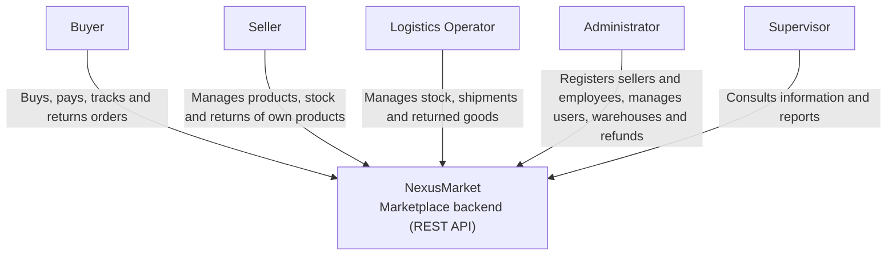

# Level 1 — System Context

NexusMarket is the backend of a marketplace where independent sellers publish physical and digital products, buyers purchase them, and the platform manages inventory, logistics and post-sale processes.

| Actor | Role Code | Main Goals |
| ----- | --------- | ---------- |
| Buyer | `BUYER` | Register publicly, buy products, pay, track shipments, request returns |
| Seller | `SELLER` | Create and publish products, manage own stock, approve returns of own products |
| Logistics Operator | `LOGISTICS_OPERATOR` | Manage stock of any warehouse, prepare and deliver shipments, receive returned goods |
| Administrator | `ADMINISTRATOR` | Register sellers (with their first warehouse) and employees, manage statuses, process refunds, see reports |
| Supervisor | `SUPERVISOR` | Read-only access to all information and reports |

There are no external systems: payments are registered as confirmed, because the functional specification does not define a payment gateway.
