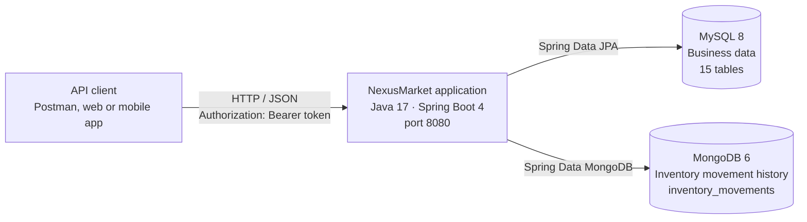

# Level 2 — Containers

| Container | Technology | Responsibility | Docker Compose Service |
| --------- | ---------- | -------------- | ---------------------- |
| Application | Java 17, Spring Boot 4.1 | REST API, business rules, security | `nexusmarket-app` |
| Relational database | MySQL 8.0 | Persons, users, warehouses, products, inventory, carts, orders, invoices, shipments, returns, refunds | `mysql-db` |
| Document database | MongoDB 6.0 | Append-only history of inventory movements | `mongo-db` |

| Service | Port on the Host | Port Inside Docker |
| ------- | ---------------- | ------------------ |
| Application | 8080 | 8080 |
| MySQL | 3307 | 3306 |
| MongoDB | 27017 | 27017 |

Inside Docker, the application reaches the databases by service name (`mysql-db:3306`, `mongo-db:27017`). The application container waits until both databases report a healthy status before starting.
