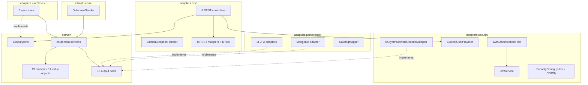

# Level 3 — Components

| Component | Package | Responsibility |
| --------- | ------- | -------------- |
| REST controllers | `adapters.rest.controllers` | Receive HTTP requests and call one input port each |
| Use cases | `adapters.useCases` | Implement the input ports by delegating to the services |
| Domain services | `domain.services` | Execute the business operations |
| Models and value objects | `domain.models`, `domain.valueobjects` | Hold the data and protect their own rules |
| Output ports | `domain.ports.out` | Describe what the domain needs from outside |
| Persistence adapters | `adapters.persistence` | Implement the output ports with MySQL and MongoDB |
| Security | `adapters.security` | JWT, access rules, CORS and password encoding |
| Seeder | `infrastructure.seed` | Creates the initial data through the domain services |

**Dependency rule:** every arrow points towards the domain. The domain does not know the adapters.
