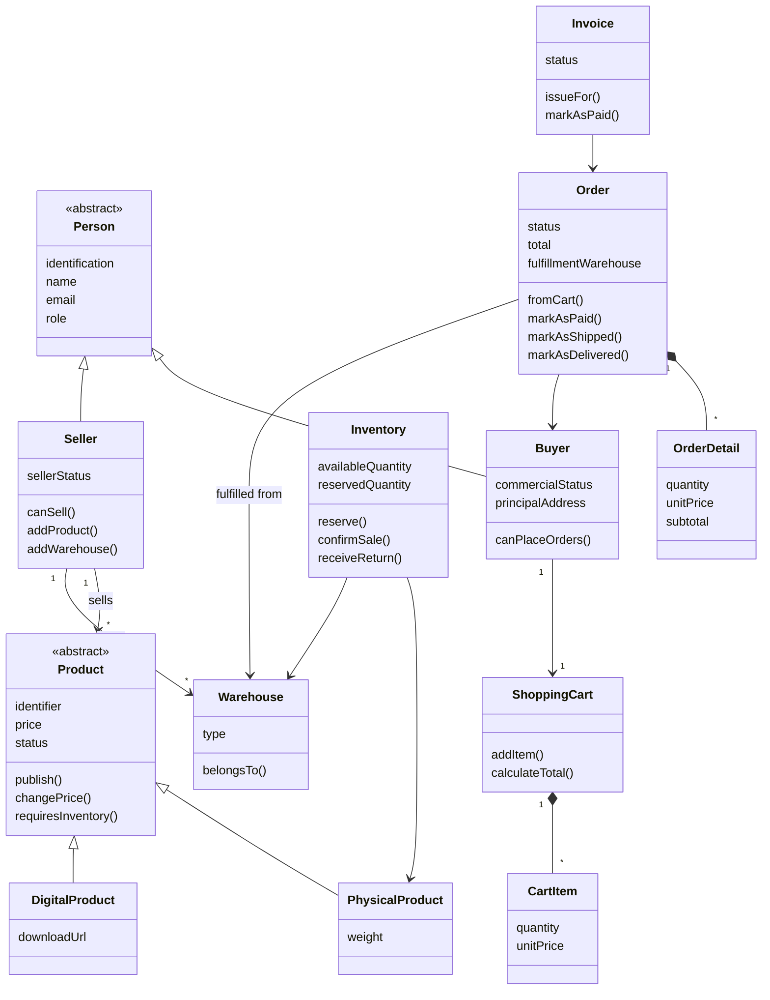
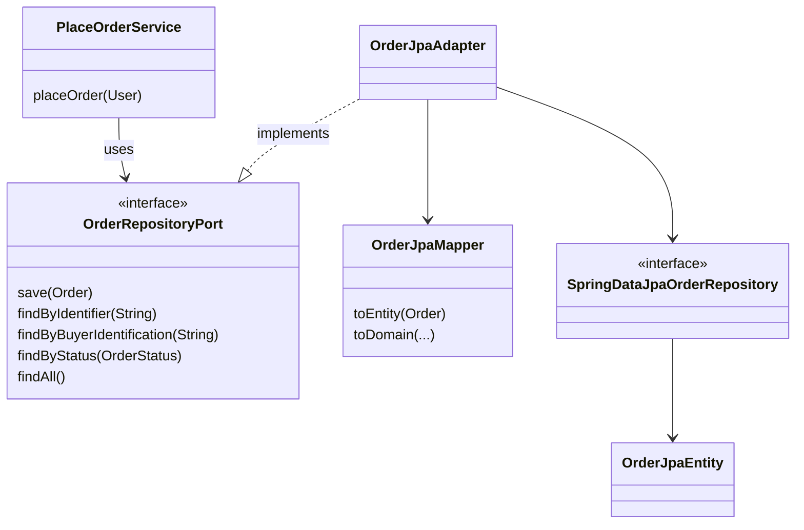

# Level 4 — Code

This level shows the main classes of the purchase domain and how a port connects the domain with an adapter. The complete list of attributes and methods is in `SDD/domain/Domain Model.md`.

## Purchase Domain

## Port and Adapter

The service depends only on the interface. Replacing MySQL with another database would mean writing a new adapter, without changing `PlaceOrderService`.
