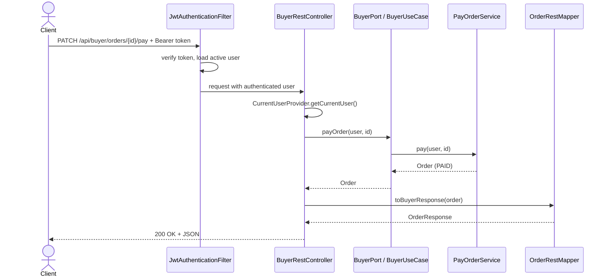

# Layer — REST Adapters (HTTP Input)

## Controllers and Base Paths

| Controller | Input Port | Base Path | Endpoints |
| ---------- | ---------- | --------- | --------- |
| `PublicRestController` | `PublicAccessPort` | `/api/public` | 3 |
| `BuyerRestController` | `BuyerPort` | `/api/buyer` | 12 |
| `SellerRestController` | `SellerPort` | `/api/seller` | 18 |
| `LogisticsOperatorRestController` | `LogisticsOperatorPort` | `/api/operator` | 17 |
| `AdministratorRestController` | `AdministratorPort` | `/api/admin` | 28 |
| `SupervisorRestController` | `SupervisorPort` | `/api/supervisor` | 16 |
| **Total** | | | **94** |

## DTOs and Mappers

* 14 request DTOs and 17 response DTOs (Java records), validated with Bean Validation.
* 8 mappers convert between DTOs and domain models.
* `GlobalExceptionHandler` turns every exception into an `ErrorResponse` with the right HTTP status.

## Sequence — Typical Protected Endpoint

Details: `SDD/Adapters/Rest-adapters.md`, `Api-rest-endpoints.md`, `Rest-validation.md`, `Global-exception-handler.md`.
