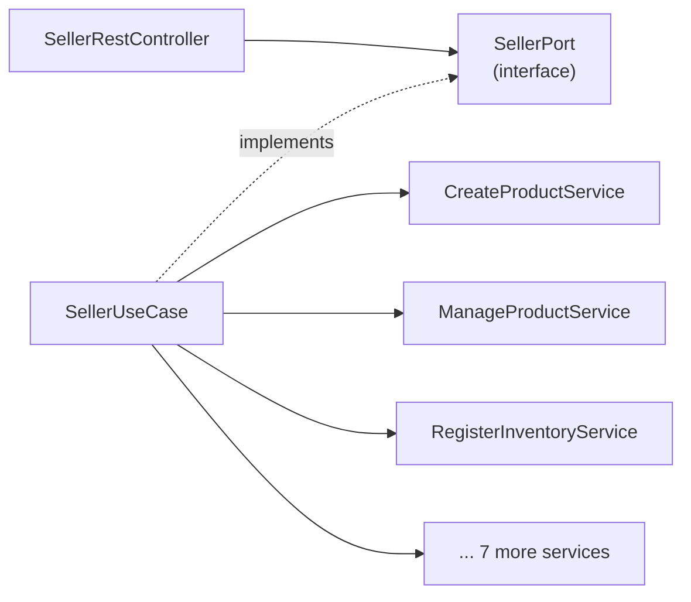

# Layer — Use Case Adapters

Each use case implements one input port and only delegates to the domain services.

| Use Case | Implements | Services | Operations |
| -------- | ---------- | -------- | ---------- |
| `PublicAccessUseCase` | `PublicAccessPort` | 3 | 3 |
| `BuyerUseCase` | `BuyerPort` | 7 | 12 |
| `SellerUseCase` | `SellerPort` | 10 | 18 |
| `LogisticsOperatorUseCase` | `LogisticsOperatorPort` | 9 | 17 |
| `AdministratorUseCase` | `AdministratorPort` | 15 | 28 |
| `SupervisorUseCase` | `SupervisorPort` | 7 | 16 |

The same service can be used by several use cases (for example, `RegisterInventoryService` by the seller and the logistics operator). The service decides what each role may do.

Details: `SDD/Adapters/Use-cases-adapters.md` and `SDD/domain/Input-ports.md`.
