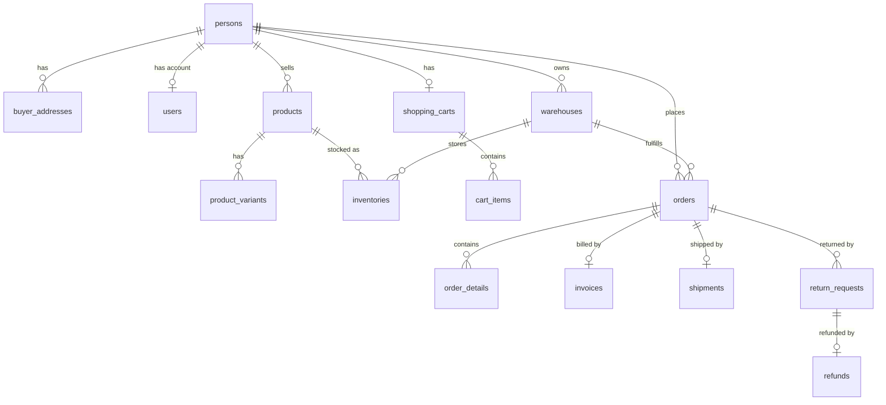
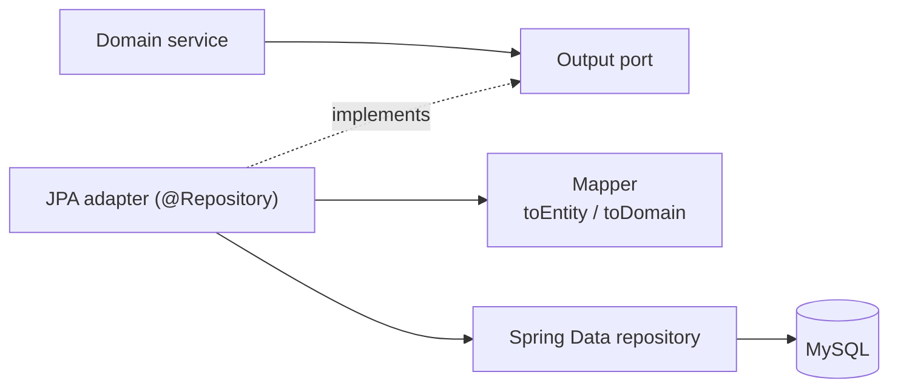

# Layer — Persistence Adapters

## Data Model (MySQL)

Relations are stored as identifiers; the adapters rebuild the related domain objects.

15 tables: 11 for the entities and 4 auxiliary tables for lists (`buyer_addresses`, `product_variants`, `cart_items`, `order_details`).

## Document Model (MongoDB)

Collection `inventory_movements`: one document per movement (`ENTRY`, `RESERVATION`, `SALE_EXIT`, `ADJUSTMENT`, `RETURN`) with inventory, product, warehouse, quantity, date and user.

## Adapter Pattern

Details: `SDD/Adapters/Persistence-adapters.md`.
