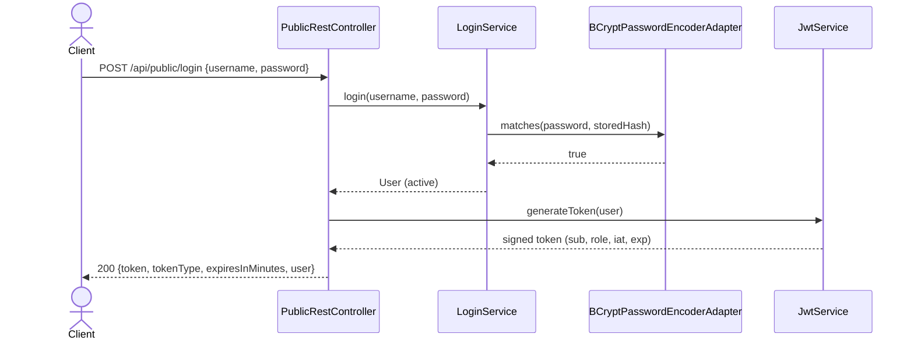
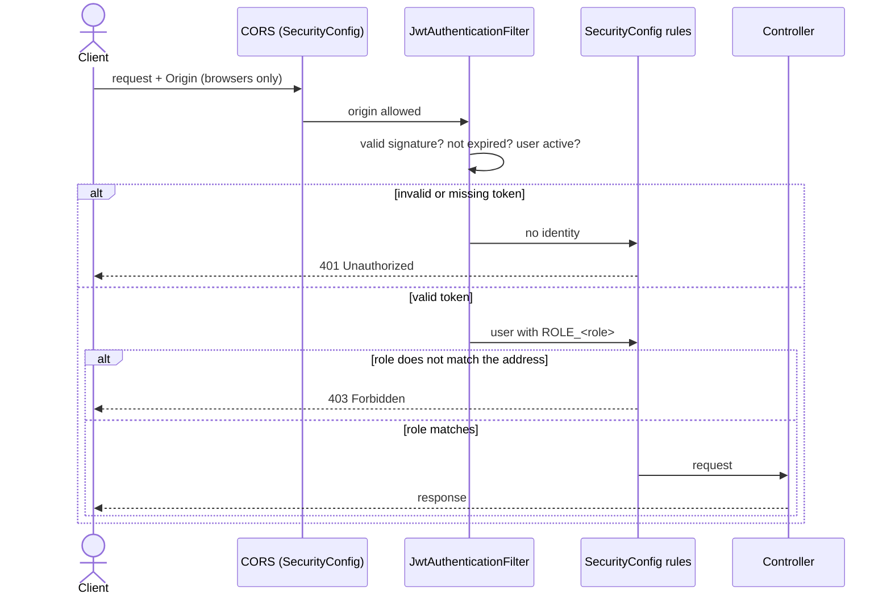

# Layer — Security Adapters

## Login

## Protected Request

| Component | Responsibility |
| --------- | -------------- |
| `JwtService` | Creates and verifies tokens (HS256, JJWT 0.12.6) |
| `JwtAuthenticationFilter` | Identifies the user of each request |
| `SecurityConfig` | Access rules by address, CORS, stateless sessions |
| `CurrentUserProvider` | Gives the authenticated user to the controllers |
| `BCryptPasswordEncoderAdapter` | Implements `PasswordEncoderPort` |

Details: `SDD/Adapters/Rest-security-cors.md`.
