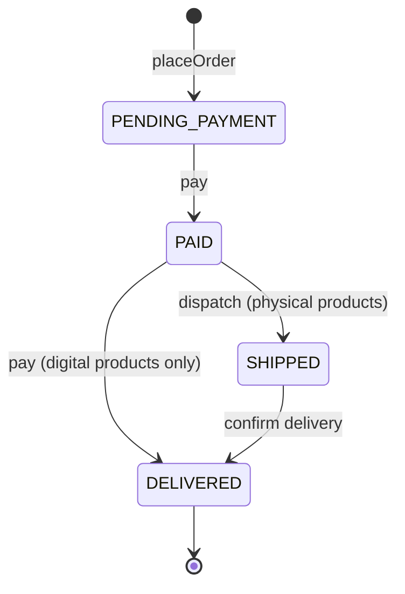
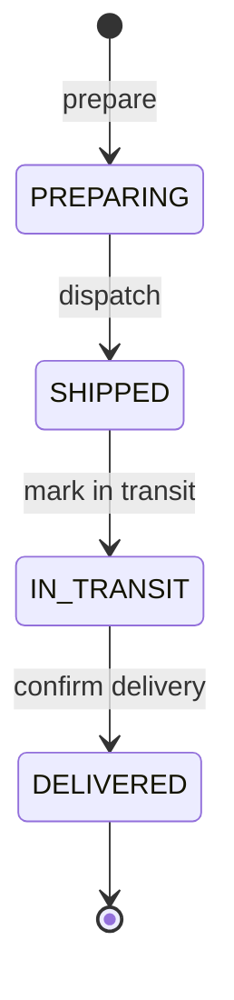
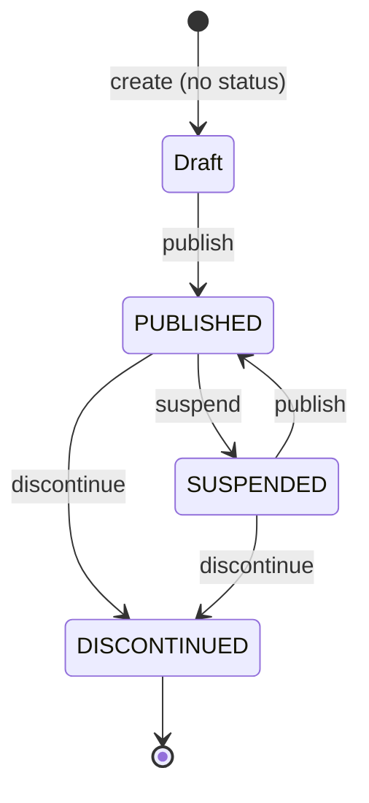
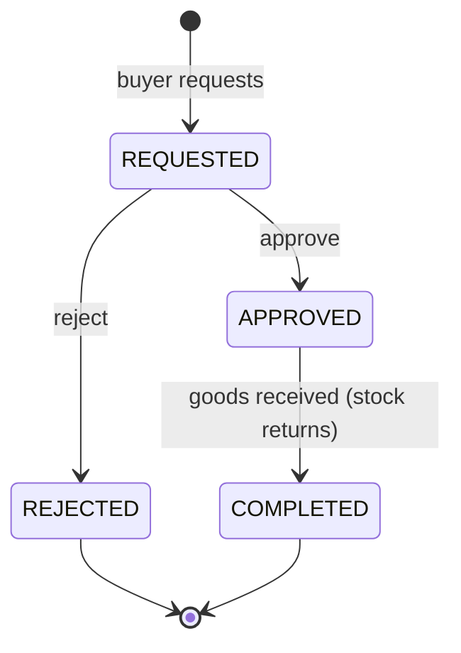
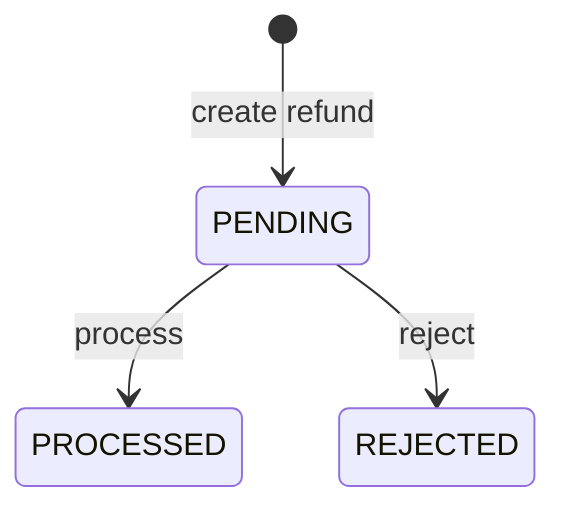

# Layer — Domain

| Package | Content | Count |
| ------- | ------- | ----- |
| `domain.models` | Entities with behavior | 19 |
| `domain.valueobjects` | Catalogs (statuses, roles, types), including the base class `DomainCatalog` | 14 |
| `domain.enums` | `ProductType` | 1 |
| `domain.exceptions` | `DomainException` and its 5 subclasses | 6 |
| `domain.services` | Business operations in 8 areas, plus `AccessValidator` | 28 |
| `domain.ports.in` | Input ports, one per role | 6 |
| `domain.ports.out` | Output ports | 13 |

## Life Cycles

### Order

A delivered order is finalized and cannot change.

### Shipment

### Product

### Return and Refund

## Inventory Cycle

| Step | Available | Reserved | Movement |
| ---- | --------- | -------- | -------- |
| Register 10 units | 10 | 0 | `ENTRY` |
| Order of 3 units placed | 7 | 3 | `RESERVATION` |
| Shipment dispatched | 7 | 0 | `SALE_EXIT` |
| Return completed | 10 | 0 | `RETURN` |

Details: `SDD/domain/`.
