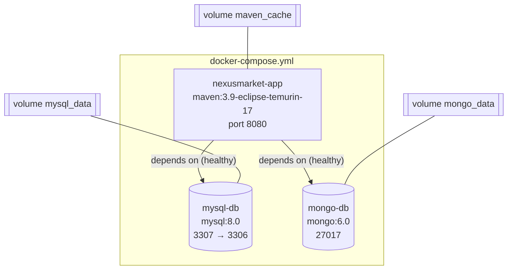

# Layer — Infrastructure

## Initial Data

`DatabaseSeeder` (`infrastructure.seed`) implements `CommandLineRunner`, so it runs when the application starts. It does nothing if the user `admin` already exists, so data is never duplicated.

It creates the first administrator directly (registering employees requires an administrator) and then uses the domain services for everything else, so the initial data follows the same business rules:

| Data | Detail |
| ---- | ------ |
| Users | `admin`, `operator`, `supervisor`, `tecnostore` (seller), `ana` (buyer) |
| Warehouses | "North Warehouse" (seller) and "Central Warehouse" (marketplace) |
| Products | A published physical product with 20 units in stock, and a published digital product |

## Configuration

`application.properties` reads every value from an environment variable with a local-development default (`${VARIABLE:default}`):

| Property | Variable |
| -------- | -------- |
| `spring.datasource.url`, `username`, `password` | `DB_URL`, `DB_USERNAME`, `DB_PASSWORD` |
| `spring.mongodb.uri` | `MONGODB_URI` |
| `jwt.secret`, `jwt.expiration-minutes` | `JWT_SECRET`, `JWT_EXPIRATION_MINUTES` |
| `cors.allowed-origins` | `CORS_ALLOWED_ORIGINS` |
| `server.port` | `SERVER_PORT` |

`spring.jpa.hibernate.ddl-auto=update` lets Hibernate create and update the MySQL tables from the entities.

## Deployment

The volumes keep the data and the downloaded dependencies when the containers stop. Step-by-step instructions are in `SETUP.md`.
